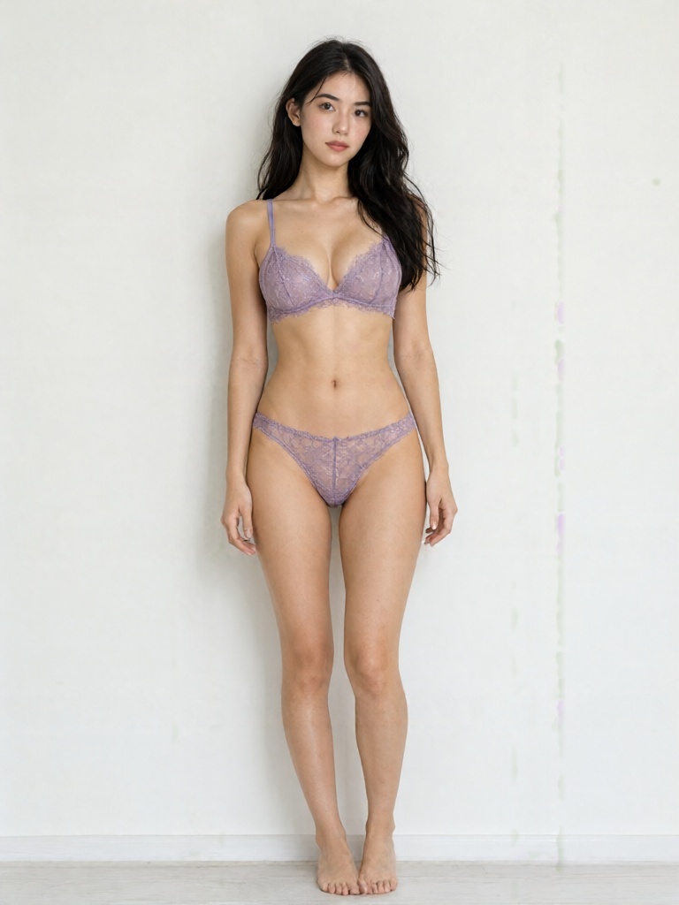
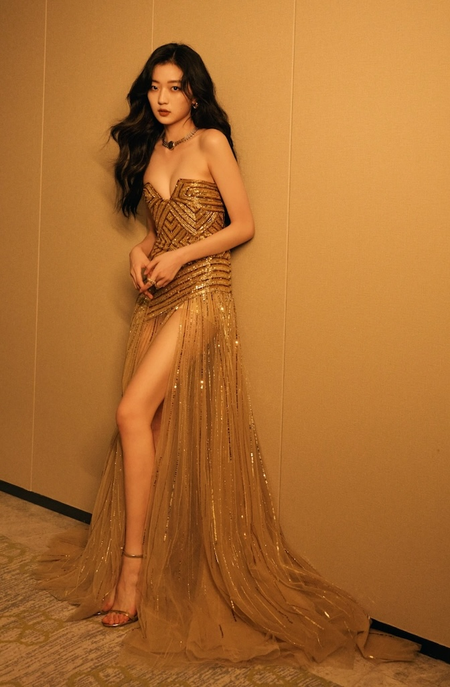
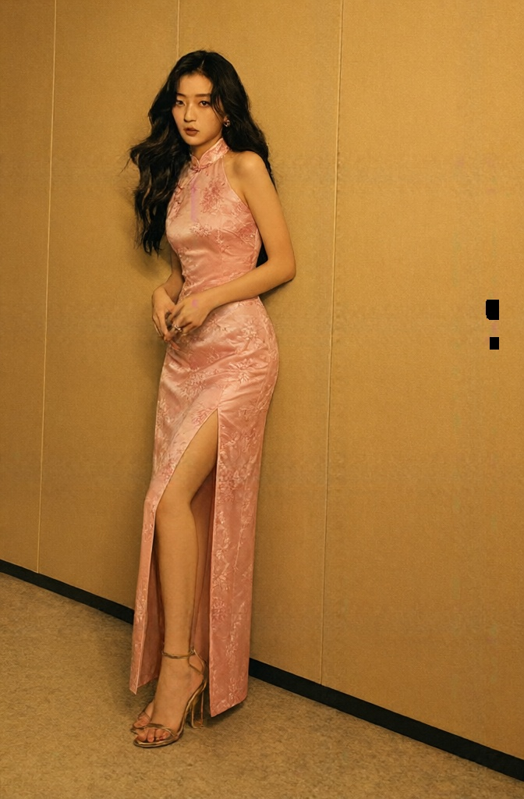
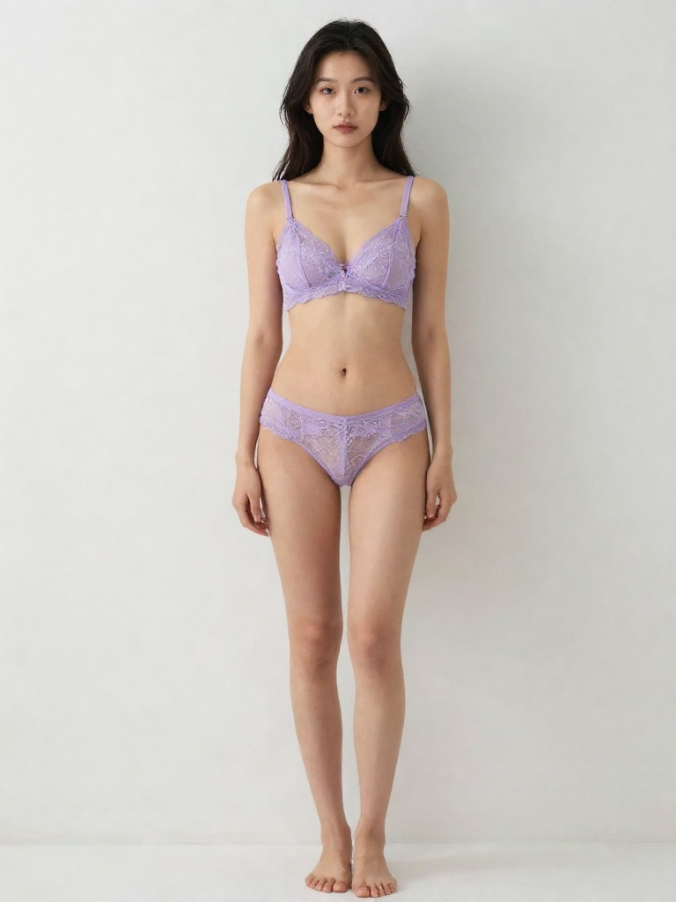
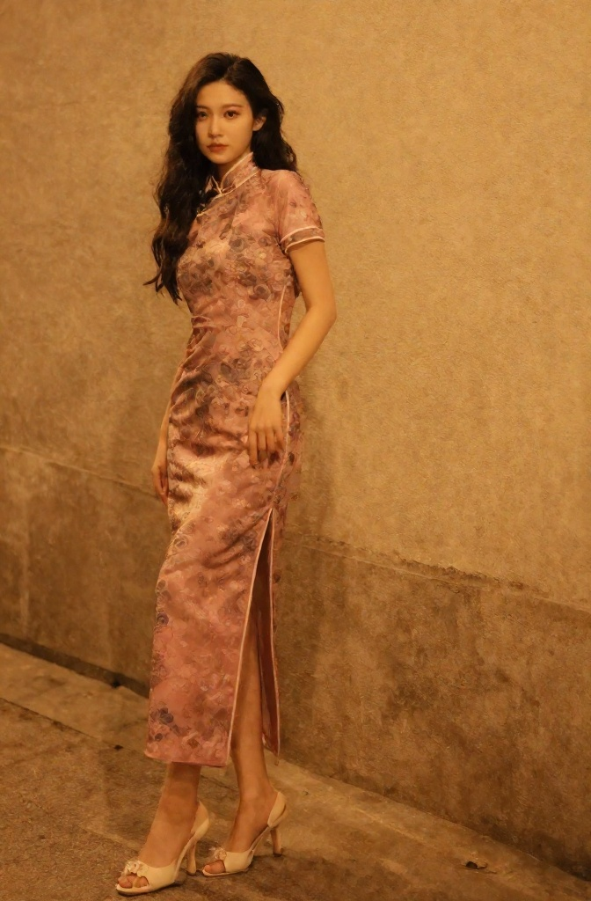

# 自然语言文本生成图像 T2I（Text To Image）

**T2I** 是（Text To Image 文生图 / 文本到图像）的缩写，指利用自然语言处理（NLP）与计算机视觉（CV）跨模态融合技术，将自然语言描述直接 **理解并生成** 为符合语义图像输出的跨模态人工智能技术。

## Qwen-Image-2.1

**Qwen-Image-2.1** 是阿里千问团队开源的一款轻量级图像生成与编辑一体化模型，其视觉生成组件仅 7B 参数，却原生支持 2K 分辨率输出与透明（RGBA）图像生成

该模型将文生图与图像编辑能力整合在同一架构中，支持最多 10 张参考图输入，并可通过圈选、涂抹或独立蒙版进行精细的局部编辑

- [基于 Qwen-Image-2.1 实现自然语言文本生成图像](./Qwen-Image-2.1/qwen_image_2.1_text_to_image.py)

  基于 Qwen-Image-2.1 模型，实现自然语言文本生成图像

  

  

  
点击展开查看

  <pre>
  Prompt:
  一张全景全身照，一位18岁可爱的中国长发女模特，皮肤较白净，自信地站立着，直视镜头。
  她身穿一套淡紫色分体式蕾丝内衣，包括精致的文胸和蕾丝内裤，均为半透光的。
  她的黑发自然下垂，表情从容。背景是纯白色的墙壁，没有多余的装饰或观众。
  光线柔和而均匀，突出了模特的气质和内衣的细节。
  高清写实风格，电影级画质，8K分辨率。
  </pre>
  
  

  

- [基于 Qwen-Image-2.1 实现根据参考图与自然语言文本生成图像](./Qwen-Image-2.1/qwen_image_2.1_text_to_image_with_reference.py)

  基于 Qwen-Image-2.1 模型，实现根据用户提供的参考图与自然语言文本，生成图像

  

  

  
点击展开查看

  <pre>
  Prompt:
  将人物改为穿粉红色的旗袍。

  保持人物的脸部、发型、身体、姿势、背景、街道环境、
  建筑物、构图和摄影角度尽可能不变。

  只修改人物的服装。

  真实摄影风格，
  自然的人物姿态，
  真实的皮肤质感，
  自然光照，
  高细节。
  </pre>
  
参考图

  
  
生成图

  
  

  

---

## Z-Image-Turbo

**Z-Image-Turbo** 是阿里通义实验室开源的一款高效文本生成图像模型，采用约 6B 参数的单流 DiT 架构，并通过蒸馏技术将生成过程压缩至约 8 个 NFE，在保持较高图像质量的同时显著提升生成速度

该模型支持中英文文本提示，在写实人物、复杂场景、构图控制以及图像中文字生成方面表现突出，并针对消费级 GPU 进行了优化，可通过量化与显存优化方案在 16GB 级别显存设备上运行

- [基于 Z-Image-Turbo 实现自然语言文本生成图像](./Z-Image-Turbo/z_image_turbo_text_to_image.py)

  基于 Z-Image-Turbo 模型，实现自然语言文本生成图像

  

  

  
点击展开查看

  <pre>
  Prompt:
  全身人像摄影，人物从头顶到脚底完整出现在画面中，头部、双肩、双臂、双手、双腿和双脚全部清晰可见。
  人物身体任何部分都没有被画面边缘裁切。
  一位18岁可爱的中国长发女模特，皮肤较白净，自信地站立着，直视镜头。
  她身穿一套淡紫色分体式蕾丝内衣，包括精致的文胸和蕾丝内裤，均为半透光的。
  她的黑发自然下垂，表情从容。背景是纯白色的墙壁，没有多余的装饰或观众。
  光线柔和而均匀，突出了模特的气质和内衣的细节。
  高清写实风格，电影级画质，8K分辨率。
  </pre>
  
  

  

- [基于 Z-Image-Turbo 实现根据参考图与自然语言文本生成图像](./Z-Image-Turbo/z_image_turbo_text_to_image_with_reference.py)

  基于 Z-Image-Turbo 模型，实现根据用户提供的参考图与自然语言文本，生成图像

  

  

  
点击展开查看

  <pre>
  Prompt:
  将人物改为穿粉红色的旗袍。

  保持人物的脸部、发型、身体、姿势、背景、街道环境、
  建筑物、构图和摄影角度尽可能不变。

  只修改人物的服装。

  真实摄影风格，
  自然的人物姿态，
  真实的皮肤质感，
  自然光照，
  高细节。
  </pre>
  
参考图

  
  
生成图

  
  

  

---

## Animagine XL 3.1

**Animagine XL 3.1** 是由 CagliostroLab 基于 Stable Diffusion XL (SDXL) 0.9/1.0 深度微调的高质量二次元/动漫风格图像生成模型。

作为 3.0 版本的改进迭代，它在动漫角色还原度、画风一致性以及对复杂提示词（Prompt）的理解能力上做出了显著提升，拥有庞大的标签库（Tag）和更精准的色彩控制，能够稳定生成高分辨率、细节丰富且极其地道的日系动漫插画与角色立绘，是目前开源社区中最顶级的 Anime 风格文生图模型之一

**注意：** 不支持中文提示词，需要先使用 `translators` 翻译为英文提示词

- [基于 Animagine XL 3.1 实现自然语言文本生成动漫图像](./Animagine-XL-3.1/animagine_xl_3.1_text_to_image.py)

  基于 Animagine XL 3.1 模型，实现自然语言文本生成动漫图像

  

  

  
点击展开查看

  <pre>
  Prompt:
  一位银色长发、蓝色眼睛的动漫少女，穿着白色连衣裙，站在盛开的樱花树下，柔和的春日阳光，精致的二次元插画。
  </pre>
  
  

  

---

## NetaYume-Lumina-Image

基于 `Lumina Image 2.0` 微调的二次元动漫图像生成模型，支持 Danbooru 标签与自然语言提示词控制，在日系动漫插画、角色立绘、丰富场景描绘与复杂提示词遵循方面具有良好的表现，兼顾角色细节刻画、色彩表现与多元素构图生成

擅长结合丰富的角色特征、服饰细节、鲜明配色、柔和光影与景深效果，呈现富有层次感和氛围感的动漫画面，兼顾复杂提示词理解、多元素构图组织与画面细节表达，适用于角色设计、唯美插画及高质量二次元场景创作

- [基于 NetaYume-Lumina-Image-2.0-Diffusers 实现自然语言文本生成动漫图像](./NetaYume-Lumina-Image/netayume_lumina_image_2.0_text_to_image.py)

  基于 NetaYume-Lumina-Image-2.0-Diffusers 模型，实现自然语言文本生成动漫图像

  

  

  
点击展开查看

  <pre>
  Prompt:
  一位银色长发、蓝色眼睛的动漫少女，穿着白色连衣裙，站在盛开的樱花树下，柔和的春日阳光，精致的二次元插画。
  </pre>
  
  

  

